# Cadence product research and roadmap decisions

Research date: **20 October 2026**. Implementation baseline: [`edee5d9`](https://github.com/ravidsrk/cadence/commit/edee5d9). Delivery plan: [ROADMAP.md](../../ROADMAP.md).

## Recommendation

Make Cadence the place to **understand, revisit, and share a developer’s observed GitHub contribution rhythm**. Keep the interactive skyline, four-pillar score, comparisons, annual recap, and embeddable graphics. Invest next in a trustworthy index, broader discovery, historical change, and useful weekly summaries.

“Global” should describe the geographic scope of discovery. A displayed rank is among a defined indexed population, at a stated time, under a stated metric version. No available discovery channel establishes that every highest-contributing account is known. Public activity also cannot establish work quality, total productivity, or the causal effect of an AI tool. These conclusions follow from GitHub’s visibility model and the measurement research below. [GitHub visibility](https://docs.github.com/en/account-and-profile/concepts/contributions-on-your-profile), [SPACE](https://www.microsoft.com/en-us/research/publication/the-space-of-developer-productivity-theres-more-to-it-than-you-think/)

The product opportunity is an inference from the evidence, not a measured demand or revenue forecast. Validate it with the activation, retention, and qualitative research work in M1.

## Method and limits

- Inspected the working implementation, `PRODUCT.md`, `DESIGN.md`, repository docs, all GitHub issues, milestones, the default-branch file tree, and repository-linked Projects. At the start of this work, the repo had no roadmap file, issue backlog, milestones, or linked project. The product documents and prior implementation plan are the baseline being extended.
- Reviewed first-party repositories and selected actual user reports using GitHub’s API. Repository capabilities are documented capabilities, not independently measured adoption or performance. Reports describe a user’s experience at a date; they do not prove that a service is currently down.
- Read official GitHub API/visibility documentation and queried the live GraphQL schema for contribution field definitions. In particular, `totalPullRequestContributions` counts PRs opened; it is not a merged-PR count. Restricted counts are viewer-dependent and nonzero only when the user shares them.
- Reviewed eight relevant arXiv papers, including 2026 material and revised versions. Consulted full-text methods, findings, and discussion sections in the GitHub streak, METR, and fake-stars studies, in addition to abstracts and publication metadata. Other paper findings below are limited to their abstracts/metadata. Published studies and preprints have different evidence strength and generalizability.
- Searched public X indexes for contribution graphs, streaks, skyline/city visualizations, README stats, and contribution growth. **No broad, structured X sample was obtained.** The configured treg credential returned HTTP 401 on a free search call. The available indexed material includes one relevant original-post excerpt and two automated topic summaries; direct opening of the original X post returned no body. No paid data batch ran.
- This is a bounded product/technical review, not an exhaustive literature review, a complete crawl of GitHub/X, or a representative survey. Search visibility favors public, popular, and English-indexed material. No interviews or Cadence retention/pricing experiments have yet been run.

## What the repository already contains

| Existing decision                               | Keep and extend                                        | Current limitation to address                                                                  |
| ----------------------------------------------- | ------------------------------------------------------ | ---------------------------------------------------------------------------------------------- |
| Public profile dashboard with 3D/2D/split views | Make observation and sharing fast                      | Measure mobile, keyboard, reduced-motion, and loading behavior                                 |
| Four-pillar Cadence score                       | Expose raw dimensions and version the existing formula | Documentation currently disagrees with implementation; no validation as a productivity measure |
| Compare and annual recap                        | Add personal change and weekly views                   | No persisted rank-history series                                                               |
| SVG/PNG/CSV exports, badge, iframe              | Improve reliable distribution and snapshots            | Hosted endpoints still depend on service availability                                          |
| Four-channel discovery and batched hydration    | Retain the architecture                                | Discovery coverage and sustained refresh are not established                                   |
| SQL materialized leaderboard and pagination     | Make SQL the authority                                 | Some window sorts and client reranking can give incomplete rankings                            |
| Heuristic automation assessment                 | Add labeled evaluation and review                      | Current rules are not a calibrated detector                                                    |
| Cron, manual CLI, migrations, PGLite preview    | Productionize and verify                               | A local build does not prove durable production storage or cron execution                      |

Validation during this review: typecheck and the test suite passed; lint returned no errors and five warnings; the production build passed. The build reported that external DB migration was skipped because `DATABASE_URL` was unset. Previous transcript smoke results are historical context, not a fresh production audit.

## GitHub landscape: what to learn and where to differ

| Project / evidence                                                                                                                                                           | Observed capability or limitation                                                                                                    | Cadence implication                                                                                                                   |
| ---------------------------------------------------------------------------------------------------------------------------------------------------------------------------- | ------------------------------------------------------------------------------------------------------------------------------------ | ------------------------------------------------------------------------------------------------------------------------------------- |
| [committers.top](https://github.com/ashkulz/committers.top#faq)                                                                                                              | Its FAQ explicitly describes follower-first sampling, free-text location gaps, and separate public/private-inclusive rankings        | Broaden discovery and disclose coverage; do not inherit its sampling cutoff as a universal leaderboard                                |
| [GitHub Readme Stats](https://github.com/anuraghazra/github-readme-stats)                                                                                                    | Customizable cards; its README calls the public hosted deployment best-effort and recommends self-hosting or Actions for reliability | Distribution reliability is a product feature; add snapshot delivery and an Actions path                                              |
| [Readme Stats issue #4737](https://github.com/anuraghazra/github-readme-stats/issues/4737)                                                                                   | A user reported a paused public deployment breaking cards in January 2026                                                            | Test last-good/static delivery rather than promising uninterrupted live badges                                                        |
| [Readme Streak Stats](https://github.com/DenverCoder1/github-readme-streak-stats)                                                                                            | Highly configurable streak cards and a static GitHub Actions workflow                                                                | Reuse the static-artifact pattern and learn from weekly-mode needs                                                                    |
| [Streak issue #805](https://github.com/DenverCoder1/github-readme-streak-stats/issues/805) and [#799](https://github.com/DenverCoder1/github-readme-streak-stats/issues/799) | Users reported token-dependent counts and weekly-mode failures                                                                       | Test viewer/visibility contexts and weekly semantics explicitly                                                                       |
| [Metrics](https://github.com/lowlighter/metrics)                                                                                                                             | Plugin-based SVG/Markdown/PDF/JSON output; isometric calendars and language/activity views                                           | A visual calendar alone is established territory; favor explanation, history, and a coherent user journey over a large plugin catalog |
| [GitHub Skyline](https://github.com/github/gh-skyline)                                                                                                                       | Official CLI extension creates 3D-printable STL contribution graphs                                                                  | Keep Cadence’s interactive browser view; treat printable export as optional later validation rather than rebuilding this tool         |
| [Git City](https://github.com/srizzon/git-city)                                                                                                                              | Interactive city, comparisons, share cards, instanced rendering/LOD, and a trailer workflow                                          | Learn from easy visual sharing and rendering budgets; test whether short skyline stories help Cadence acquisition                     |
| [OSSInsight](https://github.com/pingcap/ossinsight)                                                                                                                          | Repository/developer analytics, collections, trends, comparisons, and a data explorer                                                | Ecosystem analytics already has mature competitors; Cadence should start with personal/peer rhythm and source-linked stories          |
| [OpenDigger](https://github.com/X-lab2017/open-digger/blob/master/docs/README.md)                                                                                            | Public metric datasets, including OpenRank and developer networks                                                                    | Evaluate collaboration/impact context as a separate bounded experiment                                                                |
| [GrimoireLab](https://github.com/chaoss/grimoirelab)                                                                                                                         | Broader software-development analytics infrastructure                                                                                | Prefer established metric concepts over building an enterprise analytics suite in the near-term roadmap                               |
| [Commitgraph](https://github.com/MAKaminski/Top-Github-Users)                                                                                                                | README documents provenance, rank history, and bootstrap data; also states its intended crawler is not committed                     | Inspect actual delivery, not just screenshots or planned capabilities. Never synthesize a contribution calendar from an annual total  |

These are design references, not an instruction to copy their code. Their repositories declare different licenses: Git City is AGPL-3.0, GrimoireLab GPL-3.0, several graphics projects MIT, and OSSInsight/OpenDigger Apache-2.0. Check the exact component and data terms before reuse. License absence is not permission to reuse. Repository license files are the source for these observations.

## X: usable signals and evidence deliberately excluded

| Evidence                                                                               | What was actually available                                                      | How it affects the plan                                                                                                     |
| -------------------------------------------------------------------------------------- | -------------------------------------------------------------------------------- | --------------------------------------------------------------------------------------------------------------------------- |
| [Tim Spalding, 7 April 2026](https://x.com/librarythingtim/status/2041418452175348039) | An indexed original-post excerpt joking about having a better contribution graph | A weak anecdote that graphs participate in developer identity; a prompt to test sharing, not evidence of willingness to pay |
| [Git City topic summary](https://x.com/i/trending/2029342917584929147)                 | An automated X summary describing visual sharing and growth claims               | Useful for discovering the first-party Git City repo. Its audience/growth figures are excluded from product forecasts       |
| [Contribution-growth topic summary](https://x.com/i/trending/2025711099023159585)      | An automated summary linking contribution growth with AI tools                   | A topic to investigate. Its numerical and causal claims are not adopted as evidence                                         |

The roadmap therefore includes a bounded follow-up X study with original-post verification, date bounds, deduplication, contradictory themes, and an explicit consent-based interview program. Do not interpret the sparse indexed sample as social consensus. No social posts, replies, or outreach were sent during this research.

## Papers: findings, limitations, and product decisions

### P1. SPACE: measurement is multidimensional

[Forsgren et al., _The SPACE of Developer Productivity_, 2021](https://www.microsoft.com/en-us/research/publication/the-space-of-developer-productivity-theres-more-to-it-than-you-think/) explains why activity alone cannot measure developer productivity. Cadence can describe contribution rhythm, but cannot observe satisfaction, work quality, collaboration quality, and flow from a calendar alone. Keep the score explainable, expose dimensions, and avoid turning a product heuristic into a validated personal performance judgment.

### P2. Streak counters change behavior

[Moldon, Strohmaier, and Wachs, arXiv:2006.02371](https://arxiv.org/abs/2006.02371) analyzes GitHub’s 2016 removal of public streak counters as a natural experiment. Long streaks, weekend activity, and single-contribution days became less common afterward. Its reconstructed streaks depend on complete event data and location assumptions, and its sample favors accounts with inferable locations. The historical observational setting is not a forecast of Cadence retention. It supports testing weekly/personal rhythm and avoiding incentives that reward a meaningless daily action merely to preserve a streak.

### P3. Badges are not a shortcut to useful recognition

[Calefato, Quaranta, and Lanubile, arXiv:2303.14702v5](https://arxiv.org/abs/2303.14702v5), revised in 2024 and published in _Information and Software Technology_, examines more than 6,000 developers, a survey, and over 300 discussions. Badge reactions were mixed; relationships with qualities such as timely collaboration were weak. This evaluates GitHub’s implementation, not every reward system. Keep existing tiers explainable and prioritize evidence-backed milestones over a new trophy economy.

### P4. Bot detection needs evidence beyond volume

[Dey et al., _Detecting and Characterizing Bots that Commit Code_, arXiv:2003.03172](https://arxiv.org/abs/2003.03172) combines author names, commit messages, modified files, and project associations in BIMAN, reporting AUC-ROC 0.9 on its test data. Cadence’s daily-count heuristics do not have those features or that validation. Separate known automation, suspicion, inactivity, and missing data, and validate exclusions on a labeled held-out sample.

### P5. Published classification scores do not transfer automatically

[Golzadeh et al., arXiv:2010.03303v2](https://arxiv.org/abs/2010.03303v2) reports a labeled sample of 5,000 GitHub accounts, including 527 bots, using issue/PR-comment patterns. Its reported weighted precision/recall/F1 of 0.98 belongs to that task and dataset. It does not establish the accuracy of a calendar classifier, especially with current AI-assisted human work. Require explicit evidence and a correction path for Cadence exclusions.

### P6. Popularity signals can be manipulated

[He et al., _Six Million (Suspected) Fake Stars in GitHub_, arXiv:2412.13459v2](https://arxiv.org/abs/2412.13459v2), revised September 2025 and associated with ICSE 2026, studies anomalous starring across 2019–2024 metadata. The title changed from the earlier 4.5-million version. Its detection identifies suspected campaigns, not certain intent for every account; the authors explicitly say this evidence alone cannot justify disciplinary action. Stars can supply portfolio context but should not be the authority for a developer-quality score or bot verdict.

### P7. Contribution growth does not establish AI productivity gains

[Becker et al., METR, arXiv:2507.09089v2](https://arxiv.org/abs/2507.09089v2) randomized AI availability across 246 tasks performed by 16 experienced OSS developers in familiar repositories. Early-2025 tools increased measured completion time by 19% in that setting despite perceived speedups. The result is bounded to the sampled developers, tools, tasks, and period. Cadence should never infer causal AI benefit from an upward contribution chart or identify AI use from cadence alone.

### P8. Baseline differences confound simple comparisons

[Stray et al., arXiv:2509.20353v2](https://arxiv.org/abs/2509.20353v2), revised January 2026 and published at HICSS-59, combines 26,317 non-merge commits, 703 repositories, a 25-user/14-non-user comparison, surveys, and interviews at NAV IT. Copilot users were more active before adoption, and the study did not find statistically significant post-adoption commit-activity changes. This is a single-organization case study. Prefer transparent baselines and comparable windows, not tool-effect narratives.

### P9. Current practice combines outcomes, experience, and diagnostics

[Houck et al., _EngThrive_, arXiv:2605.04259](https://arxiv.org/abs/2605.04259), May 2026, describes Microsoft’s measurement system combining speed, ease, quality, and wellbeing with telemetry and surveys. It is an organizational practice report/preprint, not a validation of Cadence’s score. Use separate product-success and index-health metrics, and combine telemetry with direct developer feedback before committing to larger product bets.

Eight arXiv papers are covered in P2–P9; SPACE is the additional foundational publication. None establishes a universally correct weighting for Cadence’s existing score.

## Technical findings that change the sequencing

### Freshness must work before a larger crawl

In [`enqueueCandidates()` and `enqueueStaleRefresh()`](../../src/lib/github/indexer.server.ts), refreshing an existing successful candidate leaves its queue state `done`. Successful attempts and failed attempts also share a lifetime counter. Fix and test the refresh lifecycle before increasing volume.

Claims lack a durable worker owner and atomic locked selection. In-process `runInFlight` does not coordinate independent serverless invocations. Use owner-checked leases, expiry/recovery, and resumable work. A run-wide deadline must include discovery, not just processing.

### SQL and presentation need one ranking contract

[`SORT_COLUMNS`](../../src/lib/github/board.server.ts) reuses annual active-day/peak values and 30-day momentum for several requested windows. Server and client reranking then operate over loaded subsets. Rankings, ties, filtered counts, pagination, selected-day mode, and snapshots must refer to the same population and computation. A 200+ profile fixture should include an actual 7-day leader outside the annual first page.

The current language leagues use seed/trending membership against loaded rows. Present them accurately until server-side evidence-based cohorts exist. Public repository languages are not per-language commit volume.

### Discovery needs checkpoints and independent lanes

The follower sweep starts from the first page each run, fetches only two pages per bucket by default, and excludes follower counts below 1,000. Search exposes at most 1,000 results per query; persistent partitioning must split larger result sets. [GitHub Search](https://docs.github.com/en/rest/search/search)

The ClickHouse query requires several signals together. Replace this single gate with a union of bounded discovery lanes so reviewers, issue-heavy maintainers, single-repository specialists, and recent builders can be discovered independently. Use held-out known-positive recall, source yield, and overlap measurements to evaluate improvement.

GH Archive records public event activity. GitHub’s October 2025 Events API change removed push commit summaries and counts; a push is a candidate-discovery signal, not a commit total. Treat archive lag/watermark as observed metadata, with no fixed universal “45-minute” promise. [GH Archive](https://www.gharchive.org/), [GitHub changelog](https://github.blog/changelog/2025-08-08-upcoming-changes-to-github-events-api-payloads/)

### Missing and private data need explicit states

The HTML hydration fallback sets unavailable typed totals to zero. Use null/completeness metadata instead. Validate viewer/token context, preserve last good observations, and prevent a historic-year profile lookup from replacing the annual ranking snapshot. Public commit counts, anonymous private-inclusive calendar counts, and owner-visible private totals need different contracts.

The existing docs contain concrete discrepancies: storage denial in `docs/data.md`, a 24-profile cap in `docs/faq.md`, and score/tier descriptions in app docs that differ from `board.ts`. Correct these as part of M1’s shared metric/provenance contract.

### Production capacity is more than rate-limit points

The current worker defaults to 256 claimed profiles per run. Eight three-hour runs imply an upper bound of **2,048 claimed profiles/day**, before errors, timeouts, discovery time, and retries. That does not refresh a 10,000-profile index every six hours.

As a sizing example, 10,000 daily refreshes divided by eight successful users per request would require roughly 1,250 batch requests/day. That is arithmetic under an assumption, not measured capacity. Measure actual aliases completed, query cost, request latency, secondary-limit pauses, provider charges, DB work, and heavy-account fallbacks. Prioritize freshness by tier and budget rather than issuing one uniform freshness promise.

GitHub documents user-token primary limits, separate secondary/concurrency/CPU limits, and additional point deductions after timeouts. A sampled one-point query cannot justify a guaranteed throughput claim. Reserve budget for foreground lookups and stale refresh. [GitHub GraphQL limits](https://docs.github.com/en/graphql/overview/rate-limits-and-query-limits-for-the-graphql-api)

The 10,000-profile cap is currently an actual storage/admission limit, not merely a UI page size. Remove it only with compact rows, matching indexes, bounded retention, and a measured 100k-row load test.

Finally, the local generated Nitro function is `__server.func` with no emitted `maxDuration`, while `vercel.json` configures another function path. Verify the actual hosting configuration and schedule in staging. Local PGLite is useful for previews; a production shared leaderboard needs durable storage and tested migration/restore behavior.

## Architecture to evolve toward

```mermaid
flowchart LR
  sources[Public event, search, trending, organic lanes] --> checkpoints[Persisted partitions and source watermarks]
  checkpoints --> queue[Candidate queue with leases and quotas]
  queue --> verify[Adaptive GraphQL verification and bounded fallbacks]
  verify --> facts[Observed facts with visibility and completeness]
  facts --> eligibility[Versioned eligibility and review decisions]
  eligibility --> snapshots[Daily facts and ranking snapshots]
  snapshots --> query[One authoritative cohort and ranking query]
  query --> surfaces[Board, profiles, compare, recaps, embeds, API]
```

Keep Postgres and the existing TanStack stack. Add durable queue/checkpoint semantics before introducing another broker. Separate discovery from verification scheduling; isolate foreground request budgets. Keep source observations and historical snapshots distinct from derived metrics. Fetch full calendars/details on demand rather than transferring every annual calendar in board rows.

## Product bets and how to evaluate them

| Bet                                     | Reason to try                                               | Evidence needed to continue                                                           |
| --------------------------------------- | ----------------------------------------------------------- | ------------------------------------------------------------------------------------- |
| Trustworthy broader leaderboard         | Existing coverage gaps and observable correctness defects   | Held-out recall, low false exclusions, bounded freshness, consistent ranks            |
| Personal weekly recap                   | Extends an existing annual recap into a repeatable user job | Users can explain what changed and return for another recap                           |
| Maintainer/reviewer portfolio           | Activity calendars underrepresent collaboration             | Users find useful work absent from commit-only views                                  |
| Private watchlists and peer comparisons | Extends existing compare without forcing signup             | Repeat viewing and voluntarily saved peer sets                                        |
| Durable README/share artifacts          | Concrete failures reported in established card projects     | Reliable static delivery and successful exports/installs                              |
| Community boards and public API         | Adjacent use cases with established ecosystem tools         | A few active design partners/consumers and bounded support cost                       |
| AI narration and impact graph           | Potential additional context                                | Demonstrated benefit over deterministic/simple baselines, factuality, acceptable cost |

Define activated use before measuring it: a successful profile view plus an intentional day inspection, comparison, or export. Track weekly returning activated visitors, successful sharing, and useful recaps separately. Set growth targets after two weeks of baseline data; do not substitute stars or indexed-account count for retention.

Initial operational targets in the roadmap are proposed release gates, not current measurements: exact fixture ranking consistency; top-1,000 freshness p95 within six hours and other active-index freshness p95 within 48 hours after capacity validation; at least 95% known-positive benchmark recall; at least 99% measured precision for automatic exclusion; warm board query p95 under 200ms on a stated staging setup. If the budget cannot support a target, revise the service tier and label the actual freshness.

## Deliberately deferred

Keep the next releases focused. Defer a native app, a new forge ingestion system, an enterprise productivity suite, a custom 3D world, a trophy/virtual-goods economy, and an arbitrary-query analytics platform. Printable STL is already well served by GitHub Skyline. A new MCP transport should follow an actual API consumer. AI narration and impact scoring remain research-gated; private repository ingestion would need a separate product decision and explicit consent architecture.

The plan should be reviewed at each milestone using recorded evidence. A failed experiment is a reason to narrow or stop that bet, not to add more unvalidated features.
